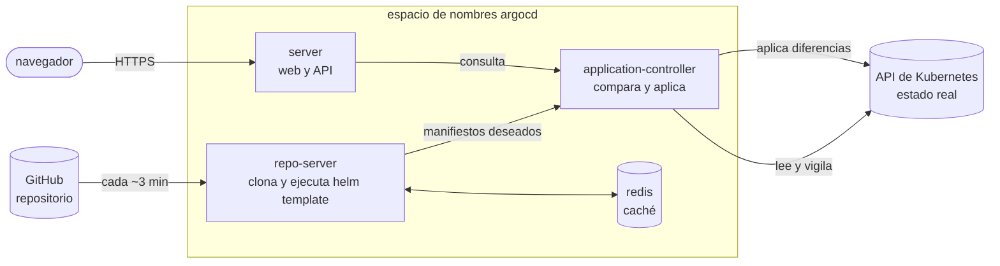
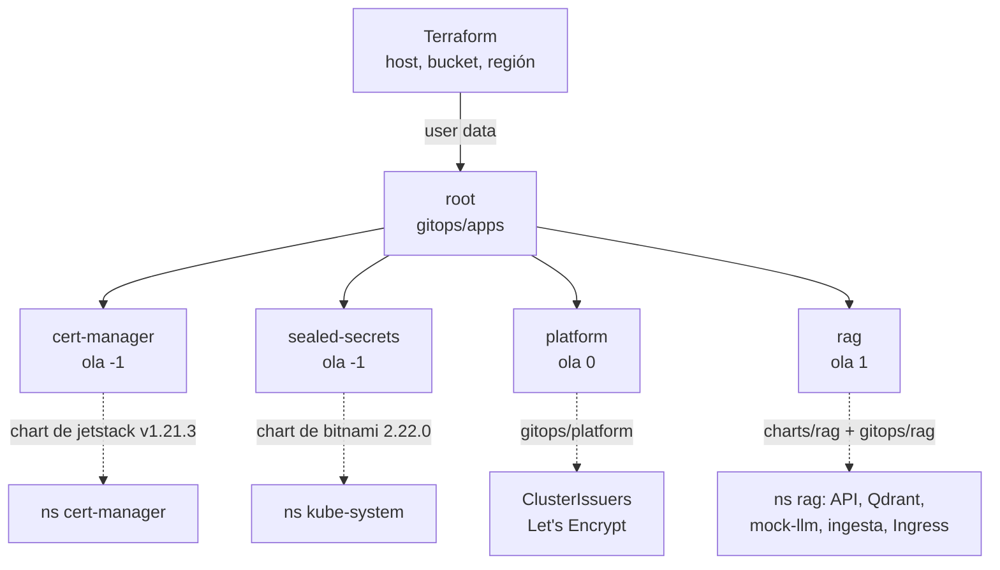
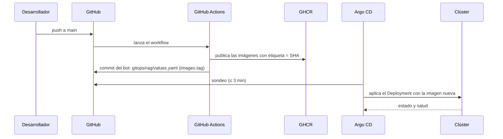

# Argo CD en este proyecto

Qué es Argo CD, qué problema resuelve, cómo funciona por dentro, cómo se usa en este proyecto, qué guarda y qué se puede hacer desde su web. Cómo entrar: [acceso.md](acceso.md). Por qué se eligió frente a Flux: capítulo 2 de la memoria; decisiones relacionadas: ADR-016 (modelo pull), ADR-022 (instalación y *app of apps*), ADR-024 (Sealed Secrets) y ADR-030 (acceso al panel), en [decisiones.md](decisiones.md).

## 1. Qué es, en una frase

Argo CD es un programa que corre **dentro** del clúster de Kubernetes y se encarga de que lo que está desplegado sea **exactamente** lo que dice un repositorio de Git. Si alguien cambia Git, lo aplica. Si alguien cambia el clúster a mano, lo deshace.

## 2. Qué problema resuelve: GitOps

Sin Argo CD, desplegar consiste en que una persona o un pipeline de CI ejecute `kubectl apply` o `helm upgrade` contra el clúster. Eso tiene tres problemas:

1. **Hay que dar credenciales del clúster a quien despliega** (al CI, por ejemplo). Si se filtran, se puede modificar el clúster entero.
2. **Nadie vigila después.** Si alguien cambia algo a mano, el clúster deja de coincidir con lo que se cree desplegado y nadie se entera. A eso se le llama **desviación** (*drift*).
3. **El historial queda repartido** entre logs del CI, la memoria de las personas y el propio clúster.

GitOps le da la vuelta: **Git es la única fuente de verdad** y un agente dentro del clúster se encarga de hacerla cumplir. Son los cuatro principios de OpenGitOps que recoge la memoria:

| Principio | Qué significa | Cómo se cumple aquí |
| --- | --- | --- |
| Declarativo | Se describe el estado deseado, no los pasos para llegar a él | Charts de Helm y manifiestos YAML en `charts/` y `gitops/` |
| Versionado e inmutable | Ese estado vive en Git, con historial | Cada despliegue es un commit; la etiqueta de la imagen es el SHA del commit |
| Extraído (*pull*) | El agente lee de Git; nadie empuja al clúster | Argo CD sondea GitHub; el CI **no** tiene credenciales del clúster |
| Reconciliado continuamente | El agente compara y corrige sin parar | Sincronización automática con `selfHeal` |

## 3. Cómo funciona por dentro

Argo CD no es un único programa sino cinco piezas, cada una en su pod del espacio de nombres `argocd`. Memoria medida el 20/11 en la t3.large:

| Componente | Qué hace | Memoria |
| --- | --- | --- |
| `argocd-repo-server` | Clona el repositorio de Git y **genera los manifiestos** finales: ejecuta `helm template` con los valores que toque. No toca el clúster | 32 MiB |
| `argocd-application-controller` | El corazón. **Compara** los manifiestos generados con lo que hay en el clúster y, si difieren, **aplica** los cambios. También calcula la salud de cada recurso | 165 MiB |
| `argocd-server` | La **web** y la API que usa la web. Es lo que se ve en `https://argocd.<ip>.sslip.io` | 48 MiB |
| `argocd-redis` | Caché: guarda los manifiestos ya generados para no repetir el trabajo | 6 MiB |
| `argocd-applicationset-controller` | Genera aplicaciones a partir de plantillas (p. ej., una por rama). **No se usa**; sigue arrancando por un fallo de configuración pendiente (§ 9) | 20 MiB |

En total, unos 270 MiB. Se han desactivado **Dex** (inicio de sesión con GitHub, Google, etc.; no hace falta con un solo usuario) y **notifications** (avisos a Slack o por correo).

Argo CD **no tiene base de datos propia**. Todo lo que sabe lo guarda como objetos de Kubernetes: las aplicaciones son recursos `Application` y la configuración son `ConfigMap` y `Secret`. Por eso, si se recrea el clúster, basta con volver a crear la aplicación raíz: el resto se reconstruye desde Git.

### El bucle de reconciliación

1. **Cada ~3 minutos** (120 s más un margen aleatorio de hasta 60 s, el valor por defecto), el repo-server mira si hay commits nuevos en la rama `main`.
2. Si los hay, genera los manifiestos de nuevo.
3. El controlador los compara con el clúster. Si coinciden, la aplicación queda **Synced**; si no, **OutOfSync**.
4. Con la sincronización automática activada, aplica las diferencias.

Hay una asimetría importante:
- **Los cambios en Git** se detectan por sondeo: tardan hasta ~3 minutos en llegar. No hay *webhook* de GitHub porque la dirección del clúster cambia en cada sesión del lab.
- **Los cambios en el clúster** (una desviación) se detectan **al instante**: el controlador está suscrito a los cambios de los recursos que gestiona y, con `selfHeal`, los revierte en segundos. Es lo que mide el escenario 2 de la evaluación.

## 4. Conceptos que aparecen en la web y en el repositorio

| Concepto | Qué es | Dónde se ve aquí |
| --- | --- | --- |
| **Application** | La unidad de Argo CD. Dice **de dónde** sale el estado deseado (`source`: repositorio, ruta o chart, versión, valores) y **a dónde** va (`destination`: clúster y espacio de nombres) | `gitops/apps/templates/*.yaml` |
| **Project** | Agrupa aplicaciones y limita qué pueden desplegar y dónde. Se usa el proyecto `default`, sin restricciones (un solo usuario) | `project: default` |
| **Sync status** | ¿Coincide el clúster con Git? *Synced* / *OutOfSync* | Cada tarjeta de la web |
| **Health status** | ¿Funciona lo desplegado? *Healthy*, *Progressing* (arrancando o esperando), *Degraded* (falla), *Missing* (no existe) | Ídem. `rag` está *Progressing* mientras la API no tiene índice |
| **Sync** | Aplicar al clúster lo que dice Git | Automático aquí (`syncPolicy.automated`) |
| **Prune** | Al sincronizar, borrar del clúster lo que se ha quitado de Git | `prune: true` |
| **Self-heal** | Deshacer los cambios hechos a mano en el clúster | `selfHeal: true` |
| **Refresh** | Volver a comparar Git con el clúster sin esperar al sondeo. *Hard refresh* además vacía la caché y regenera los manifiestos | Botón de la web |
| **Sync wave** | Orden de despliegue: primero las de número menor, y espera a que estén sanas | Anotación `argocd.argoproj.io/sync-wave` |
| **Hook** | Recurso que se ejecuta en un momento de la sincronización en lugar de quedarse desplegado (p. ej., un Job) | El Job `rag-ingest-inicial` (hook `Sync`, ADR-027) |
| **Sync options** | Ajustes de cómo se aplica | `CreateNamespace`, `ServerSideApply`, `SkipDryRunOnMissingResource` |
| **Retry** | Reintentos si la sincronización falla | `retry: limit 10`, de 30 s a 5 min |

## 5. Cómo se usa en este proyecto

### 5.1. Instalación: la única pieza que no instala Argo CD

Argo CD no puede instalarse a sí mismo: alguien tiene que ponerlo en marcha la primera vez. Lo hace el script de arranque de la máquina ([install-k3s.sh.tftpl](../infra/cluster/install-k3s.sh.tftpl)), que Terraform pasa como *user data*:

1. Instala k3s.
2. Carga la clave de Sealed Secrets desde SSM (ADR-024).
3. Escribe un recurso `HelmChart` con el chart oficial de Argo CD (versión 10.11.6, Argo CD v3.5.6). El controlador de Helm que trae k3s lo instala solo: no hace falta instalar `helm` en la máquina (ADR-022).
4. Espera a que el repo-server esté listo y crea la **aplicación raíz** (`root`).

Valores de la instalación y su motivo:

| Valor | Por qué |
| --- | --- |
| `global.domain: argocd.<ip>.sslip.io` | Nombre público del panel |
| `server.insecure: true` | El HTTPS lo termina Traefik con el certificado de Let's Encrypt; dentro del clúster, Argo CD habla HTTP. Evita cifrar dos veces y los bucles de redirección |
| `server.ingress` con `cert-manager.io/cluster-issuer: letsencrypt` | Publica el panel por Traefik y pide el certificado automáticamente |
| `dex.enabled: false`, `notifications.enabled: false` | No se usan; ahorran memoria |

### 5.2. App of apps

En lugar de crear cada aplicación a mano, se crea una sola, `root`, que apunta a la carpeta `gitops/apps`. Esa carpeta es un chart de Helm cuyas plantillas son **otras aplicaciones**. Así, añadir un componente nuevo al clúster es añadir un fichero a `gitops/apps/templates/` y hacer commit (ADR-022).

| Aplicación | Origen | Destino | Ola | Por qué en esa ola |
| --- | --- | --- | --- | --- |
| `root` | `gitops/apps` de este repositorio, con los valores del entorno que le pasa Terraform | `argocd` | — | La crea el arranque, no Git |
| `cert-manager` | Chart externo `jetstack/cert-manager` v1.21.3, con sus CRD | `cert-manager` | −1 | Los emisores y los certificados dependen de sus CRD |
| `sealed-secrets` | Chart externo `bitnami/sealed-secrets` 2.22.0 | `kube-system` | −1 | Tiene que descifrar los secretos antes de que arranque la API |
| `platform` | `gitops/platform`: los emisores `letsencrypt` y `letsencrypt-staging` | (todo el clúster) | 0 | Necesita los CRD de cert-manager |
| `rag` | Tres fuentes de este repositorio: el chart `charts/rag`, los valores `gitops/rag/values.yaml` y los secretos de `gitops/rag/secrets/` | `rag` | 1 | Necesita los secretos y los emisores |

**Cómo llegan los valores del entorno.** La IP y la cuenta cambian en cada sesión del lab, así que no pueden estar fijas en Git. Terraform las pone en la aplicación raíz (`helm.valuesObject`), y el chart `gitops/apps` las reparte: `host` y `ingest.bucket` van a la aplicación `rag`. Todo lo demás sí está en Git.

**Robustez del arranque.** En un clúster vacío, el orden importa y algunas cosas fallan la primera vez: los CRD de cert-manager aún no existen cuando se crean los emisores. Por eso `platform` y `rag` tienen `SkipDryRunOnMissingResource` (no validar contra un tipo que aún no existe) y reintentos. Medido: del commit a todo el sistema con HTTPS, 1 min 45 s.

### 5.3. El recorrido de un cambio

- **Cambio de código** (`app/`, `mock-llm/`): el CI construye las imágenes y escribe su etiqueta en Git. Argo CD despliega esa etiqueta.
- **Cambio de configuración** (`charts/`, `gitops/`): no hace falta CI. Argo CD lo ve en Git y lo aplica. Ejemplo: el cambio de 10 a 5 candidatos del reranker (ADR-031) es solo un valor del chart.
- **Volver atrás**: `git revert` del commit y push. Argo CD despliega la versión anterior.

## 6. Qué contiene y dónde

| Qué | Dónde | Notas |
| --- | --- | --- |
| Las aplicaciones | Recursos `Application` en el espacio de nombres `argocd` | `kubectl -n argocd get applications` |
| La contraseña inicial de `admin` | Secreto `argocd-initial-admin-secret` | Aleatoria en cada clúster; la lee `infra/argocd-password.sh` |
| Su configuración interna (clave de firma de sesiones, contraseña cifrada) | Secreto `argocd-secret` | No se toca |
| El certificado HTTPS del panel | Secreto `argocd-server-tls` | Lo crea y renueva cert-manager |
| Historial de despliegues | Dentro de cada `Application` (`status.history`) | Los 10 últimos por defecto |
| Credenciales de Git | Ninguna | El repositorio es público: Argo CD solo lee |

Argo CD **no guarda** los materiales del máster ni los secretos en claro: solo ve los `SealedSecret` cifrados que hay en Git. Quien los descifra es el controlador de Sealed Secrets.

## 7. Recorrido por la web

**Pantalla principal (Applications).** Una tarjeta por aplicación con su estado de sincronización y de salud, el repositorio, la revisión desplegada y la hora de la última sincronización. Arriba, filtros y cambio de vista (tarjetas, lista o resumen).

**Detalle de una aplicación** (pulsar una tarjeta):
- **Árbol de recursos**: de izquierda a derecha, la aplicación y lo que crea. Por ejemplo, en `rag`: Deployment → ReplicaSet → Pod; StatefulSet de Qdrant → Pod → volumen; CronJob; Ingress → Service; Certificate. Cada icono muestra su salud. Hay otras vistas: por pods, por red y en lista.
- **Pulsar un recurso** abre su panel: *Summary* (estado), *Manifest* (el YAML vivo), *Diff* (diferencia con Git), *Events* (eventos de Kubernetes) y, en los pods, **Logs**. Es la forma más cómoda de seguir la ingesta: pod del Job `rag-ingest-inicial` → *Logs*.
- **Botones de arriba**:

| Botón | Qué hace | ¿Usarlo aquí? |
| --- | --- | --- |
| **Details** | Parámetros de la aplicación: origen, destino, valores de Helm, política de sincronización | Sí, para consultar |
| **Diff** | Qué cambiaría si se sincronizara ahora | Sí |
| **Sync** | Sincroniza ya, sin esperar al sondeo. Permite elegir recursos y opciones | Sí, para no esperar 3 min |
| **Sync status / History and rollback** | Última operación y lista de despliegues, cada uno con su commit | Sí, para consultar. El *rollback* desde la web está bloqueado con la sincronización automática activada: aquí se vuelve atrás con `git revert` |
| **Refresh** / *Hard refresh* | Vuelve a comparar con Git / además vacía la caché | Sí |
| **Delete** | Borra la aplicación y, si se elige en cascada, **todo lo que despliega** | **No** (§ 8) |

**User Info** (icono de usuario): muestra el usuario y permite cambiar la contraseña. **Settings**: repositorios, clústeres, proyectos y cuentas registrados (aquí, solo el propio clúster y el proyecto `default`).

## 8. Qué se puede hacer, qué pasa y qué conviene

| Acción | Qué pasa | ¿Conviene? |
| --- | --- | --- |
| Mirar estados, árbol, logs, eventos, diff, historial | Nada cambia | Sí. Es su uso principal y sirve para las capturas de la memoria |
| *Sync* o *Refresh* | Aplica lo que ya dice Git | Sí, sin riesgo |
| Borrar un **pod** | Kubernetes lo recrea (lo hace el ReplicaSet, no Argo CD); la API vuelve en ~1–2 min mientras carga los modelos | Inofensivo, pero la app no responde ese rato |
| Cambiar un recurso a mano (escalar un Deployment, editar el YAML en la web o con `kubectl`) | Pasa a *OutOfSync* y `selfHeal` lo **deshace** en segundos | Solo como experimento: es el escenario 2 de la evaluación |
| Lanzar una reindexación | `kubectl -n rag create job --from=cronjob/rag-ingest ...` ([acceso.md](acceso.md)). Un Job lanzado así no está en Git: Argo CD lo muestra pero no lo borra | Sí, cuando cambian los materiales |
| Cambiar la configuración | Commit en `charts/` o `gitops/`; Argo CD lo aplica | Sí: así se cambia todo |
| *Delete* de `rag`, `platform`, etc. | `root` la vuelve a crear desde Git en la siguiente sincronización. En cascada, además borra sus recursos: el volumen de Qdrant se pierde y hay que reindexar (~21 min) | No |
| *Delete* de `root` en cascada | Borra **todas** las aplicaciones y todo lo que despliegan. `root` no está en Git: no vuelve sola. Habría que recrear la máquina | **Nunca** |

**Experimentos útiles para la memoria** (ninguno rompe nada):
1. *Ver un despliegue*: hacer un cambio pequeño de configuración, push, pulsar *Refresh* en `rag` y ver la tarjeta pasar de *OutOfSync* a *Synced*, con el commit nuevo en *History*.
2. *Ver una desviación corregida*: `kubectl -n rag scale deploy rag-mock-llm --replicas=2` (por SSM) y ver cómo vuelve a 1.
3. *Seguir la ingesta*: logs del Job inicial en un clúster nuevo.

## 9. Limitaciones y pendientes

- **Un solo usuario (`admin`)** con contraseña aleatoria y panel público con HTTPS (ADR-030). En un entorno real: inicio de sesión con un proveedor de identidad (Dex o SSO), cuentas de solo lectura y el panel detrás de una VPN.
- **Sondeo de 3 minutos**: el plazo de un cambio puede crecer hasta en 3 minutos. Con una dirección fija, un *webhook* de GitHub lo haría inmediato.
- **ApplicationSet sigue arrancando** pese a `applicationSet.enabled: false`: en el chart 10.x la opción tiene otro nombre. Solo gasta ~20 MiB; se corregirá.
- **Sin CLI `argocd`**: no se ha instalado porque la web y `kubectl` por SSM bastan.
