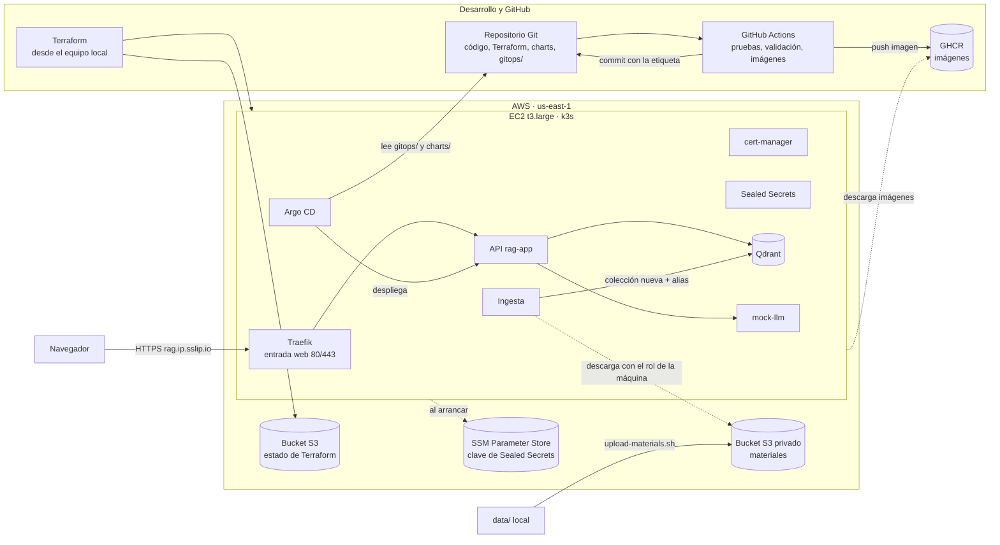
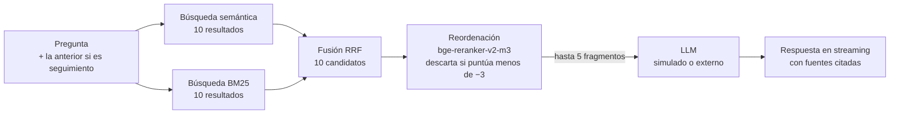
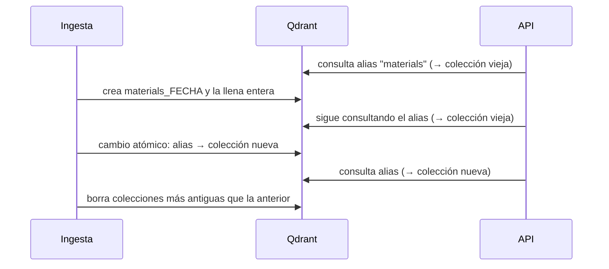
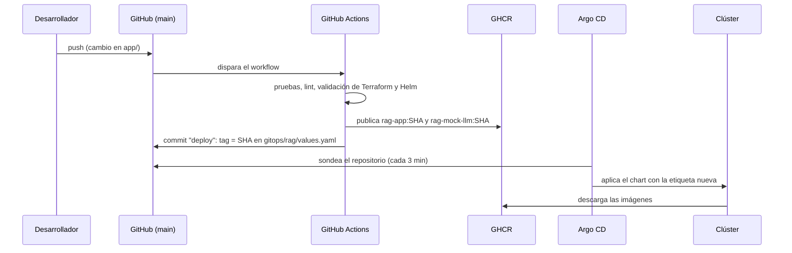
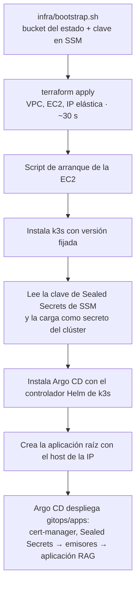

# Arquitectura

El sistema es un conjunto de componentes independientes en contenedores, desplegados en un clúster k3s de un solo nodo sobre una máquina virtual de AWS. Todo se crea desde código: Terraform crea la máquina y el arranque deja el clúster en manos de Argo CD, que despliega el resto desde este repositorio.

## Vista general

## Componentes

| Componente | Qué hace | Dónde está definido |
| --- | --- | --- |
| API (`rag-app`) | Recibe preguntas, busca en Qdrant, reordena, llama al LLM y responde con fuentes; sirve el chat web y las métricas | `app/src/rag/`, `charts/rag/templates/api.yaml` |
| Ingesta | Descarga los materiales del bucket privado, anonimiza, trocea, vectoriza y construye una colección nueva; mueve el alias. Se ejecuta como CronJob diario y como Job inicial (solo si no hay índice) | `app/src/rag/ingest/` (misma imagen que la API), `charts/rag/templates/ingest.yaml` |
| Bucket de materiales | Almacenamiento privado de los ficheros de las asignaturas, fuera de Git | `infra/bootstrap.sh`, `infra/upload-materials.sh` |
| Qdrant | Base de datos vectorial con vectores densos y BM25; la API consulta siempre el alias `materials` | `charts/rag/templates/qdrant.yaml` |
| mock-llm | Imita la API de OpenAI con respuesta fija y latencia configurable | `mock-llm/`, `charts/rag/templates/mock-llm.yaml` |
| Traefik | Controlador de entrada incluido en k3s; recibe el tráfico de los puertos 80 y 443 | k3s |
| cert-manager | Pide y renueva los certificados TLS a Let's Encrypt | `gitops/apps/templates/cert-manager.yaml`, `gitops/platform/` |
| Sealed Secrets | Descifra en el clúster los secretos cifrados guardados en Git | `gitops/apps/templates/sealed-secrets.yaml` |
| Argo CD | Compara el clúster con Git y lo sincroniza; corrige cambios manuales | arranque de la máquina (`infra/cluster/install-k3s.sh.tftpl`) |
| Infraestructura | VPC, subred, grupo de seguridad, EC2, IP elástica | `infra/cluster/` (Terraform) |

## Flujo de una consulta

## Flujo de reindexación sin corte

## Flujo de un cambio hasta producción (GitOps)

El CI no tiene credenciales del clúster: la entrega la hace Argo CD tirando de Git (modelo *pull*). Ver ADR-016.

## Arranque del clúster desde cero

El arranque de la máquina termina en ~93 s; a partir de ahí todo lo demás llega desde Git sin intervención manual (RNF1, RNF2).

## Organización del repositorio

| Ruta | Contenido |
| --- | --- |
| `app/` | Aplicación (API e ingesta), pruebas y Dockerfile |
| `mock-llm/` | LLM simulado |
| `charts/rag/` | Chart de Helm de la aplicación |
| `gitops/apps/` | Chart "app of apps": las aplicaciones de Argo CD |
| `gitops/platform/` | Recursos de plataforma (emisores de certificados) |
| `gitops/rag/` | Valores del entorno (etiqueta de imagen) y secretos cifrados |
| `gitops/sealed-secrets-cert.pem` | Certificado público para cifrar secretos |
| `infra/cluster/` | Terraform de la infraestructura y script de arranque |
| `infra/bootstrap.sh`, `infra/sealed-secrets-key.sh` | Preparación de cada cuenta de AWS |
| `.github/workflows/ci.yml` | Integración continua |
| `docker-compose.yml` | Entorno de desarrollo local |
| `docs/` | Esta documentación |
